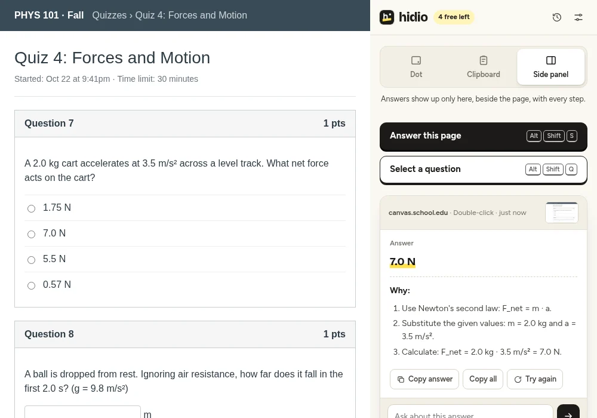
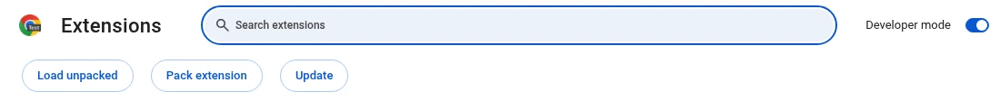
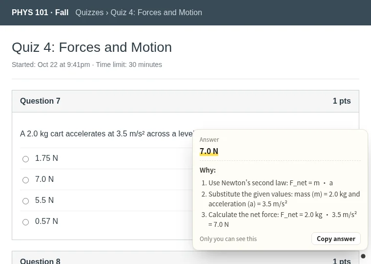

# Hidio for Chrome

Instant answers to homework and quiz questions, right where you're working. Double-click any question on the page and the answer is ready in a few seconds: copied silently to your clipboard, shown in a tiny dot in the corner, or worked out step by step in Chrome's side panel.

Website: [hidio.app](https://hidio.app) · Web version (paste a screenshot, works on any device): [hidio.app/app](https://hidio.app/app/) · Windows app: [hidio.app/install](https://hidio.app/install/#windows)

## What you get

- **Answers in seconds.** Multiple choice, short answer, math, code, essays. Double-click the question, drag a box around it, or right-click highlighted text, and the answer appears.
- **Ask a follow-up.** Not sure why? Ask right under the answer, or have it answered again.
- **Three ways to read the answer.** Clipboard (nothing on screen, just paste), a faint dot in the corner you hover to reveal, or the full side panel with every step. Switch with `Alt+Shift+M`.
- **Nothing on the page itself.** Clipboard mode draws nothing at all. The side panel lives outside the web page, so it isn't part of a shared tab. A ✓ on the toolbar icon tells you the answer is ready.
- **Yours to adjust.** Move the dot to any corner, change its size and visibility, turn double-click off on sites where you don't want it, and look back at recent answers.
- **Works where your coursework is.** Canvas, Blackboard, Moodle, McGraw Hill Connect, Pearson MyLab, Google Forms, Quizlet, Khan Academy and any other site.
- **5 free answers** to start, then $7.99/week or $19.99/month for unlimited. Cancel anytime.

## Install

This repository contains the complete, ready-to-load extension. It's the same build served at [hidio.app/install](https://hidio.app/install/).

1. Click the green **Code** button above and choose **Download ZIP**, or grab `hidio-extension.zip` from the [latest release](../../releases/latest). Unzip it. Keep the folder somewhere permanent, like Documents.
2. Open a new tab and go to `chrome://extensions`.
3. Turn on **Developer mode** (top-right switch).
4. Click **Load unpacked** and select the unzipped folder. Click the puzzle-piece icon in the toolbar and pin Hidio.

Works in Chrome, Edge, Brave, Arc and any other Chromium browser on Windows, Mac, Linux and Chromebook.

## Using it

1. Click the Hidio icon and sign in with your email (a 6-digit code, no password).
2. Open your assignment and **double-click a question**, or press `Alt+Shift+S`. To pick one question out of a busy page, press `Alt+Shift+Q` and drag a box around it. You can also highlight text and right-click → **Answer with Hidio**.
3. Read the answer the way you like: hover the dot in the corner, paste from your clipboard when the icon shows ✓, or open the side panel for the full explanation and follow-up questions.

## Windows app

For anything that isn't in the browser, or when you share your whole screen, the Windows app floats over everything and reads whatever is on screen with one shortcut. Windows keeps its window out of screenshots, recordings and screen sharing. Download at [hidio.app/install](https://hidio.app/install/#windows).

## Links

- Website: https://hidio.app
- Pricing: https://hidio.app/#pricing
- Compare extensions: https://hidio.app/best-ai-homework-helper-extensions/
- Support: support@hidio.app
- [Terms](https://hidio.app/terms/) · [Privacy](https://hidio.app/privacy/) · [Refunds](https://hidio.app/refunds/)
